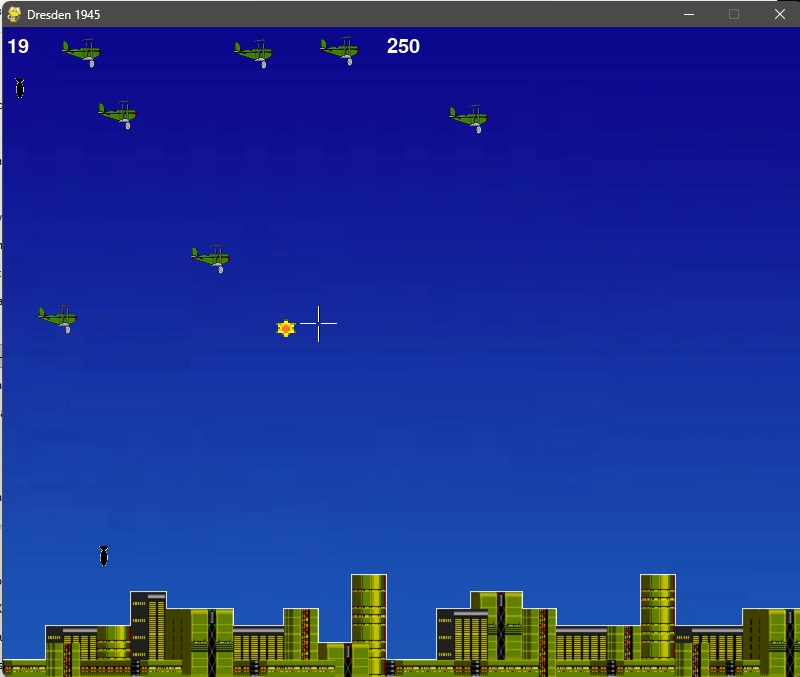
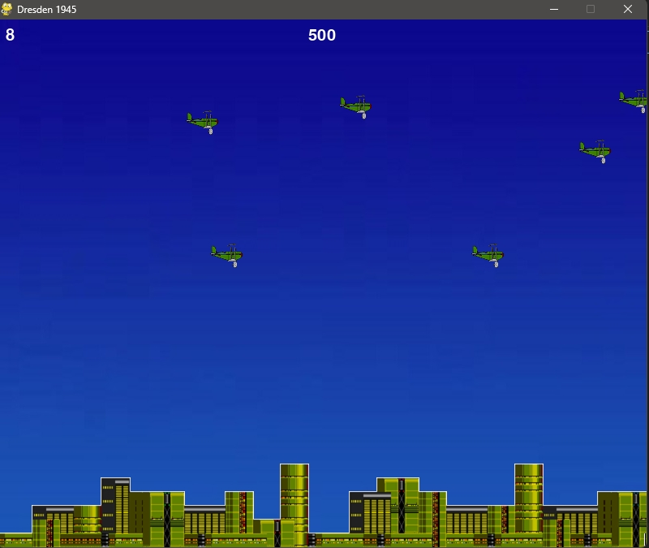
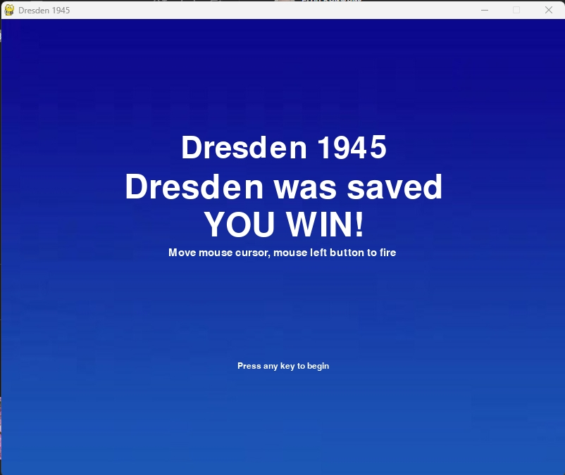
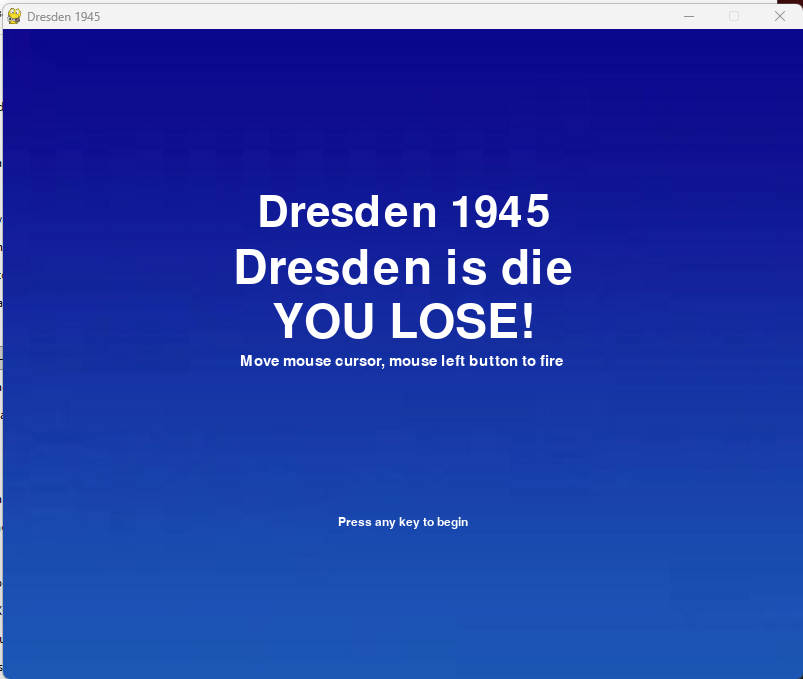

# Dresden 1945 (2D Arcade Shooter)

Законченный игровой проект на Python (Pygame) — аркадный симулятор ПВО. 
Игрок управляет зенитным орудием и защищает город от налета авиации.

## 🎮 Особенности геймплея
- **Случайный спавн:** самолеты появляются с разной скоростью и на разной высоте.
- **Баллистика:** сброшенные бомбы падают вниз.
- **Управление:** зенитка следит за курсором мыши, выстрел — левая кнопка мыши.
- **Игровой баланс:** система очков за сбитую технику, система штрафов (жизней) за пропущенные бомбы.
- **Завершенность:** есть экраны победы (город спасен) и поражения (город уничтожен), а также таймер/счетчик очков.

## 🛠 Стек технологий
- **Язык:** Python 3
- **Библиотека:** Pygame
- **Архитектура:** ООП (классы Player, Mob, Bullet, Bomb, Explosion, Grass), работа с игровым циклом, коллизиями и анимациями спрайтов.

## 📸 Скриншоты

## ⚙️ Как запустить
1. Установите зависимости: 
   `pip install -r requirements.txt`
2. Запустите игру: 
   `python Dresden.py`

## 📝 Примечание
Проект выполнен в качестве учебной работы. Все графические и звуковые ассеты взяты из открытых бесплатных источников.
